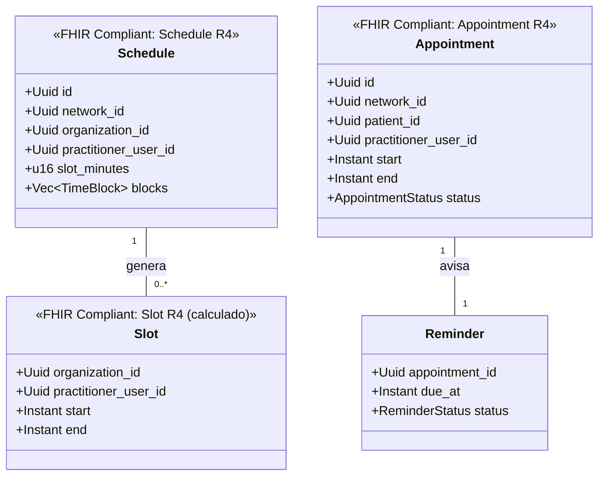

# Reserva de Citas Bounded Context (`crates/scheduling`)

## Especificación del Dominio

* **Responsabilidad**: horario de cada médico por clínica (`Schedule`), cupos (`Slot`), citas (`Appointment`), llegada y verificación del documento, recordatorios y vínculo de pacientes registrados sin cuenta.
* **Grupo FHIR**: FHIR Workflow.
* **Recursos FHIR Mapeados**: `Schedule`, `Slot`, `Appointment` (HL7 FHIR R4).
* **Estado**: ✅ **implementado** (cambio OpenSpec `scheduling-appointments`).
* **Specs**: [`practitioner-availability`](../../../openspec/specs/scheduling/practitioner-availability/spec.md), [`appointment-booking`](../../../openspec/specs/scheduling/appointment-booking/spec.md), [`check-in`](../../../openspec/specs/scheduling/check-in/spec.md), [`appointment-reminders`](../../../openspec/specs/scheduling/appointment-reminders/spec.md) e [`identity/patient-account-linking`](../../../openspec/specs/identity/patient-account-linking/spec.md). Mientras el cambio no se archive, viven en `openspec/changes/scheduling-appointments/specs/`.

## Estructura

| Capa | Módulo | Qué contiene |
|---|---|---|
| `domain` | `calendar.rs` | Único uso de `jiff`: instantes UTC, horas locales, zonas IANA y horario de verano. |
| | `schedule.rs` | `Schedule` (franjas semanales, duración), `ScheduleException`, `Slot` y `Availability` (cupos libres = horario − excepciones − citas − pasado − ventana de 60 días). |
| | `appointment.rs` | `Appointment` y sus transiciones (`book`, `cancel`, `reschedule`, `check_in`, `mark_no_show`) con auditoría. |
| | `reminder.rs` | `Reminder`, `due_at`, backoff y el texto del aviso (sin datos clínicos). |
| | `repository.rs` | Puertos `ScheduleRepository`, `AppointmentRepository` y `ReminderRepository`. |
| `application` | `integration.rs` | Puertos hacia otros contextos: `ClinicDirectory`, `PatientRegistry`, `IdentityVerification`, `NotificationSender`, `ReminderScheduler` y `Clock`. |
| | `*_usecase.rs` | Horario y disponibilidad pública, reservas, recepción y recordatorios. |
| `infrastructure` | `repository.rs`, `worker.rs` | Postgres (esquema `scheduling`) y la cola apalis `scheduling-reminders`. |
| — | `testing.rs` | Dobles en memoria de todos los puertos. |

Los adaptadores de `integration.rs` viven en `bin/clickcare/src/infrastructure/scheduling.rs`: este crate **no depende** de `administration` ni de `user`.

## Reglas de Dominio

* **La cita nace confirmada (`booked`)**, aunque la identidad del paciente aún no esté verificada en persona. La certeza de la identidad se eleva en el check-in.
* **Datos obligatorios al reservar**: el paciente necesita nombres, apellido paterno, documento y teléfono (`ProtectedAction::ConfirmAppointment`). Si faltan, la regla de `app_core::domain::access` responde cuáles y el frontend abre «Completa tus datos». A un paciente nuevo que registra recepción le faltan datos → `INVALID_ARGUMENT`.
* **La exclusión vive en la tabla de citas, no en el `Slot`**: `EXCLUDE USING gist (network_id WITH =, practitioner_user_id WITH =, period WITH &&) WHERE status IN ('BOOKED','ARRIVED')`. Cubre «un cupo, una cita», las reservas simultáneas y las citas que se cruzan entre clínicas de la misma organización, aun con duraciones distintas. Violarla responde `ABORTED` («el cupo ya no está disponible»). Los cupos se calculan, no se guardan.
* **Aislamiento por organización**: toda tabla y la exclusión llevan `network_id` (la Organization raíz). Ninguna consulta cruza organizaciones; cada una podría vivir en su propia base.
* **Horario sin cruces en la red**: al guardar un horario, bajo un advisory lock por red y médico, se compara con su horario en las otras clínicas de la misma organización y se responde solo el día y la franja del conflicto.
* **Recordatorios: antes repetido que perdido**. La tabla `reminder` es la fuente de verdad; la cola solo despierta al worker. El reclamo `PENDING → SENDING` por `(id, due_at)` evita duplicados normales; un envío que queda en `SENDING` más de `REMINDER_SENDING_TIMEOUT` se reenvía.
* **Vínculo de pacientes sin fusión**: `administration.patient_link` une un registro sin cuenta con la cuenta; deshacerlo solo cierra el vínculo. Lo confirma recepción con el documento físico a la vista, nunca el sistema por coincidencia de DNI.

## Diagrama de Clases

