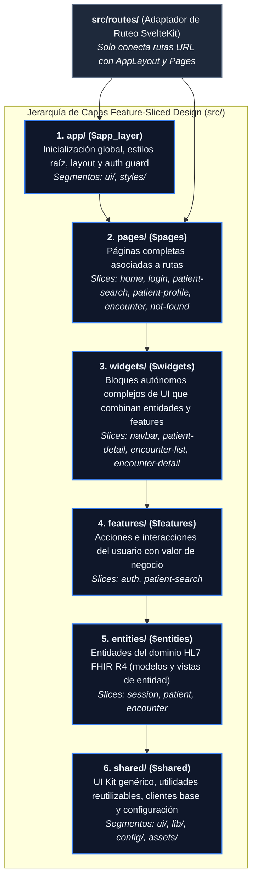

# Guía Técnica del Frontend (`frontendts/`) — Feature-Sliced Design (FSD)

## Descripción del Proyecto

**My Health Record (Frontend)** es una aplicación web desarrollada en **Svelte 5**, **SvelteKit** (`@sveltejs/adapter-static`), **TypeScript** y **Tailwind CSS v4**, estructurada bajo la metodología arquitectónica **Feature-Sliced Design (FSD v2.1)** y alineada con el modelo de dominio **HL7 FHIR R4** del backend.

---

## 1. Principios Arquitectónicos: Feature-Sliced Design (FSD)

El proyecto utiliza **Feature-Sliced Design (FSD)** en lugar de Atomic Design para organizar el código por **responsabilidad arquitectónica (Layers)**, **dominios de negocio / recursos FHIR (Slices)** y **propósito técnico (Segments)**.

### 1.1. Los Tres Conceptos de FSD

1. **Layers (Capas)**: Nivel superior de directorio en `src/`. Están estandarizadas y ordenadas verticalmente según su nivel de acoplamiento y alcance.
2. **Slices (Rebanadas de Negocio)**: Subdirectorios dentro de `pages/`, `widgets/`, `features/` y `entities/`. Particionan el código por dominio de negocio o recurso **HL7 FHIR R4** (`patient`, `encounter`, `session`, etc.). Las capas `app/` y `shared/` **no tienen slices**, ya que no pertenecen a un dominio específico.
3. **Segments (Segmentos Técnicos)**: Subdirectorios dentro de cada Slice (o directamente dentro de `app/` y `shared/`) que agrupan el código por su naturaleza técnica:
   * `ui/` — Componentes Svelte (`.svelte`), estilos locales, formateadores visuales.
   * `model/` — Modelos de dominio, esquemas, tipos, stores/estados reactivos y lógica de negocio.
   * `api/` — Clientes gRPC-Web, peticiones al backend, DTOs y mappers.
   * `lib/` — Utilidades y helpers internos al slice o compartidos en `shared/lib`.
   * `config/` — Constantes, rutas, banderas de configuración.



---

## 2. Reglas de Oro de FSD (Obligatorias)

### 2.1. Regla de Importación entre Capas (Unidireccionalidad)
> [!IMPORTANT]
> Un módulo en una capa **SOLO puede importar de capas estrictamente inferiores**. Están prohibidas las importaciones hacia capas superiores o entre distintos slices de la misma capa.

| Capa | Alias SvelteKit | Puede importar de | ¿Tiene Slices? |
| :--- | :--- | :--- | :---: |
| **`routes/`** | *(Nativo SvelteKit)* | `$app_layer/*`, `$pages/*` | ❌ (Rutas URL) |
| **`app/`** | `$app_layer` | `$pages`, `$widgets`, `$features`, `$entities`, `$shared` | ❌ (Solo segmentos) |
| **`pages/`** | `$pages` | `$widgets`, `$features`, `$entities`, `$shared` | ✅ |
| **`widgets/`** | `$widgets` | `$features`, `$entities`, `$shared` | ✅ |
| **`features/`** | `$features` | `$entities`, `$shared` | ✅ |
| **`entities/`** | `$entities` | `$shared` | ✅ |
| **`shared/`** | `$shared` | Paquetes externos / runtime `$app/*` de SvelteKit | ❌ (Solo segmentos) |

### 2.2. Regla de Aislamiento entre Slices
* Dos slices dentro de la misma capa (por ejemplo, `$features/auth` y `$features/patient-search`, o `$entities/patient` y `$entities/encounter`) **no pueden importarse directamente entre sí**.
* La composición entre distintas entidades o features debe realizarse en una capa superior (`widgets/` o `pages/`).

### 2.3. Regla de API Pública (`index.ts`)
* Cada **Slice** (en `entities/`, `features/`, `widgets/`, `pages/`) y cada **Segmento** de `shared/` y `app/` debe exponer un archivo `index.ts` en su raíz que actúe como su **API Pública**.
* Las capas externas deben importar siempre desde el alias del slice/segmento y nunca adentrarse en sus archivos internos:
  * ✅ **Correcto**: `import { Patient, MedicalConditionsCard } from "$entities/patient";`
  * ✅ **Correcto**: `import { Input, SubmitButton } from "$shared/ui";`
  * ❌ **Incorrecto**: `import Patient from "$entities/patient/model/Patient";`
  * ❌ **Incorrecto**: `import Input from "$shared/ui/input/Input.svelte";`

---

## 3. Estructura de Directorios Actual

```text
frontendts/
├── AGENTS.md                        # Esta guía arquitectónica FSD
├── svelte.config.js                 # Alias FSD ($shared, $entities, $features, $widgets, $pages, $app_layer)
├── package.json                     # Scripts y dependencias (Bun + Vite)
└── src/
    ├── app.html                     # Plantilla HTML raíz de SvelteKit
    ├── app.d.ts                     # Declaraciones de tipos globales de SvelteKit
    │
    ├── routes/                      # 🧭 Adaptador delgado de ruteo (SvelteKit File-Based Routing)
    │   ├── +layout.svelte           # Renderiza <AppLayout> de $app_layer/ui
    │   ├── +page.svelte             # Renderiza <HomePage> de $pages/home
    │   ├── login/+page.svelte       # Renderiza <LoginPage> de $pages/login
    │   ├── search/+page.svelte      # Renderiza <PatientSearchPage> de $pages/patient-search
    │   ├── patients/[id]/
    │   │   ├── +page.svelte         # Renderiza <PatientProfilePage> de $pages/patient-profile
    │   │   └── encounters/[id]/
    │   │       └── +page.svelte     # Renderiza <EncounterPage> de $pages/encounter
    │   └── [...404]/+page.svelte    # Renderiza <NotFoundPage> de $pages/not-found
    │
    ├── app/                         # 🏛️ Capa 1: Configuración global de la aplicación ($app_layer)
    │   ├── styles/app.css           # Estilos globales y utilidades de Tailwind CSS v4
    │   └── ui/
    │       ├── AppLayout.svelte     # Layout global, guardia de autenticación y contenedor principal
    │       └── index.ts             # API pública de $app_layer/ui
    │
    ├── pages/                       # 📄 Capa 2: Páginas completas de la aplicación ($pages)
    │   ├── home/                    # Slice: Página de inicio
    │   ├── login/                   # Slice: Página de inicio de sesión
    │   ├── patient-search/          # Slice: Búsqueda de pacientes
    │   ├── patient-profile/         # Slice: Ficha integral del paciente e historial de atenciones
    │   ├── encounter/               # Slice: Vista de una atención clínica (Encounter)
    │   └── not-found/               # Slice: Página 404
    │
    ├── widgets/                     # 🧩 Capa 3: Bloques autónomos de UI ($widgets)
    │   ├── navbar/                  # Slice: Barra de navegación principal
    │   ├── patient-detail/          # Slice: Ficha editable de datos demográficos y clínicos del paciente
    │   ├── encounter-list/          # Slice: Listado cronológico de atenciones clínicas
    │   └── encounter-detail/        # Slice: Panel detallado de síntomas, diagnóstico y tratamiento
    │
    ├── features/                    # ⚡ Capa 4: Casos de uso e interacciones del usuario ($features)
    │   ├── auth/                    # Slice: Formulario de login local y autenticación Google FedCM
    │   └── patient-search/          # Slice: Buscador interactivo de pacientes por nombre
    │
    ├── entities/                    # 🧬 Capa 5: Entidades de Dominio HL7 FHIR R4 ($entities)
    │   ├── session/                 # Slice: Estado reactivo de sesión y token de usuario (authStore)
    │   ├── patient/                 # Slice: Entidad FHIR Patient, Address, MedicalConditions y vistas base
    │   └── encounter/               # Slice: Entidad FHIR Encounter (EncounterEntity, State)
    │
    └── shared/                      # 🛠️ Capa 6: Núcleo compartido desacoplado del negocio ($shared)
        ├── assets/                  # Recursos estáticos importables (svelte.svg)
        ├── config/routes/           # Definición centralizada de rutas (ROOT, LOGIN, SEARCH, HISTORY) y Page
        ├── lib/logger/              # Servicio transversal de logging (loglevel)
        └── ui/                      # UI Kit base plano (button, checkbox, input, modal, title)
```

---

## 4. Alineación entre Backend (DDD / FHIR) y Frontend (FSD)

Cuando se agregue o conecte funcionalidad con un Bounded Context del backend en Rust (`backend/crates/*`), sigue esta correspondencia en FSD:

| Concepto Backend (Rust / FHIR R4) | Ubicación en Frontend FSD (`frontendts/src/`) |
| :--- | :--- |
| **Recurso FHIR / Entidad de Dominio** (`Patient`, `Encounter`, `Practitioner`, `Appointment`) | `src/entities/<recurso>/model/` y vistas base en `src/entities/<recurso>/ui/` |
| **Caso de Uso / Acción de Usuario** (`RegisterUser`, `SearchPatient`, `BookAppointment`) | `src/features/<accion>/` (`ui/`, `model/`, `api/`) |
| **Sección Completa de Pantalla** (Agenda médica, Ficha de paciente, Cabecera clínica) | `src/widgets/<bloque>/` |
| **Vista de Ruta Completa** (`/patients/[id]`, `/search`, `/login`) | `src/pages/<pagina>/` conectada desde `src/routes/<ruta>/+page.svelte` |
| **Clientes gRPC-Web Base, UI Kit, Loggers, Constantes** | `src/shared/` (`api/`, `ui/`, `lib/`, `config/`) |

---

## 5. Convenciones de Código y Comandos

1. **Svelte 5 Runes y Snippets**:
   * Usar **Svelte 5 Runes** (`$props()`, `$state()`, `$derived()`, `$effect()`, `$bindable()`) en todos los componentes.
   * Usar `{@render children?.()}` (`Snippet`) en lugar del antiguo `<slot />` de Svelte 4.
   * Usar atributos de eventos nativos de Svelte 5 (`onclick`, `onsubmit`, `onkeydown`, `onclickcapture`) en lugar de la directiva deprecada `on:click`.
2. **TypeScript Estricto**:
   * Evitar tipos envoltorio (`Boolean`, `String`, `Number`); usar siempre primitivos (`boolean`, `string`, `number`).
   * Todo cambio debe pasar `bun run check` con **0 errores y 0 advertencias**.

### Comandos de Verificación y Construcción (desde `frontendts/`)

```bash
bun install             # Instalar dependencias
bun run dev             # Iniciar servidor de desarrollo Vite
bun run check           # Sincronizar tipos de SvelteKit y ejecutar svelte-check
bun run build           # Compilar aplicación estática para producción
```
